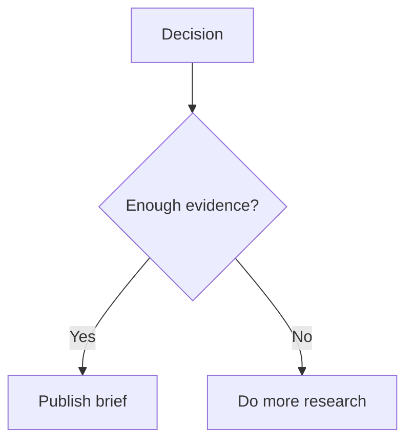

# Briefkit

[Read this README as a Briefkit report](https://taylorcjensen.github.io/briefkit/)

Briefkit turns Markdown or MDX folders into local, static, decision-oriented report websites.

It is built for agent-authored briefs: research summaries, comparisons, evidence packs, audits, risk registers, status reports, and one-off decision pages. The source stays simple and portable. Briefkit supplies the shared shell: layout, sidebar navigation, heading TOC, dark/light/auto theme, callouts, tooltips, Mermaid diagrams, table normalization, and structured response forms.

Briefkit is not an app framework, dashboard backend, CMS, or structured-data prison. The goal is to keep nuanced analysis easy to write while making the result readable enough to hand to a human.

## What it does

| Need | Briefkit behavior |
|---|---|
| Fast local report | Run `briefkit dev /path/to/report` and get a live site |
| Portable source | Use `README.md`, `index.md`, or `pages/*.md` |
| Full components | Use `index.mdx` or `pages/*.mdx` |
| Scannable tables | Markdown tables are automatically styled and width-normalized |
| Mermaid diagrams | Use fenced `mermaid` blocks or the `Mermaid` MDX component |
| Color themes | Use `ColorTheme` for Base16, Base24, or custom palettes with click-to-copy swatches |
| Structured decisions | Put `UserRespond` beside the explanation, then wait for its answers from the CLI |
| Decision artifacts | Use callouts, dense tables, sidebars, and heading TOCs |
| Throwaway output | Build static files to `{report-folder}/brief/` |
| Durable backups | Optionally retain the latest searchable source and built site after `build` or `publish` |

## Install

### From npm

```bash
npm install -g briefkit
```

Then run:

```bash
briefkit dev /path/to/report
briefkit build /path/to/report
briefkit publish /path/to/report
```

### From this repository

```bash
git clone https://github.com/taylorcjensen/briefkit.git
cd briefkit
npm install
npm link
```

Then run:

```bash
briefkit dev examples/readme-report
briefkit build examples/basic-report
```

Without linking:

```bash
npm run briefkit -- dev examples/readme-report
npm run briefkit -- build examples/basic-report
```

## Commands

```bash
briefkit dev [report-dir] [--port 4311] [--no-open] [--color-mode auto|light|dark]
briefkit build [report-dir] [--out ./brief] [--wait-for-response|--serve-responses] [--port 4311] [--no-open] [--color-mode auto|light|dark]
briefkit publish [report-dir] [--wait-for-response] [--no-open] [--duration 90d|3mo|1y|forever] [--indexed|--no-indexed] [--target https://briefs.example.com] [--api-key KEY]
briefkit responses <slug-or-url> [--target https://briefs.example.com] [--api-key KEY]
briefkit responses <revision-id> --local
briefkit unpublish <url-or-slug> [--target https://briefs.example.com] [--api-key KEY]
briefkit config set --backup-dir /path/to/backups
briefkit publish-config set --target https://briefs.example.com --api-key KEY
```

| Command | Use it for | Output |
|---|---|---|
| `dev` | Primary authoring workflow | Live Astro dev server |
| `build` | Saved static artifact | `{report-folder}/brief/` by default |
| `publish` | Build and upload a static brief | Hosted URL from your publish server |
| `responses` | Read saved answers without consuming them | JSON inbox |
| `unpublish` | Delete a hosted brief by URL or slug | Removed static brief |
| `config` | Save a global backup directory | `~/.config/briefkit/config.json` |
| `publish-config` | Save a default publish target and API key | `~/.config/briefkit/publish.json` |

`briefkit dev` opens the browser by default. Agent workflows should not open a separate browser tab after running it. Use `--no-open` only when you explicitly do not want a browser opened.

`build` and `publish` also open the browser when `--wait-for-response` is present. The command blocks until a `UserRespond` form is submitted, then prints the structured response as JSON on its final output line. This lets an agent receive the answers through the same shell tool call that launched Briefkit.

Build/dev generated Astro workspaces live under the OS temp directory. The report folder only needs to contain your source files and optional build output.

### Single-file offline build

For a one-page brief, opt in to a self-contained HTML file:

```sh
briefkit build /path/to/report --single-html --out /path/to/brief.html
```

Without `--out`, this writes `brief.html` in the report directory. Open the file directly with `file://`; no local server is needed. Local images, fonts, CSS, emitted JavaScript, and Mermaid runtime assets are embedded. Existing directory builds and publishing are unchanged. This mode requires exactly one visible page at `/`; it rejects missing or external rendering assets, unsupported asset types, CSS `@import`, linked local pages, and response forms. `--wait-for-response` is not supported offline. External hyperlinks are allowed but need a connection when followed. Client scripts that fetch data at runtime or create workers are not supported. If a configured backup directory is present, this mode does not create a site backup.

Briefkit refuses to replace an existing HTML file unless its adjacent `.briefkit-owner.json` marker matches the previously generated file's content. If you edit the HTML by hand, choose a new output path or move the edited file aside before rebuilding.

## Requirements and output ownership

Briefkit requires Node.js 22.12 or newer.

Briefkit only replaces a non-empty build output directory when that directory contains Briefkit's ownership marker, `.briefkit-output.json`. This prevents accidental deletion of hand-authored files.

If you have a legacy Briefkit output directory from before ownership markers were written:

1. Confirm the directory is generated output, not source material.
2. Make a backup or rename it, for example `mv brief brief.backup`.
3. Run `briefkit build /path/to/report` again. Briefkit will create fresh output and write the marker.
4. After checking the rebuilt site, delete the backup.

If Briefkit refuses to build because an unmarked directory is non-empty, do not add the marker by hand unless you are certain every file in that directory is disposable generated output. The safest recovery is to move the directory aside and rebuild.

## Backing up ephemeral briefs

Configure a global backup directory when report sources normally live in `/tmp` or another disposable location:

```bash
briefkit config set --backup-dir ~/.local/share/briefkit/backups
```

After every successful local build, Briefkit stores the current report under the configured directory. Publish creates the backup after the static build succeeds and before uploading it. Each backup contains:

```text
<backup-directory>/<report-id>/
  manifest.json
  source/
  site/
```

`source/` is a searchable copy of the report source. Briefkit excludes `.git`, `node_modules`, and the active build output. `site/` contains the built static report. Rebuilding the same report replaces its prior snapshot; Briefkit does not retain version history.

By default, the report ID combines the source directory name with a hash of its canonical path. Give a report a stable explicit ID when its temporary source path may change:

```js
export default {
  title: 'Vendor Decision Brief',
  backup: { id: 'vendor-decision' },
};
```

Explicit IDs may contain letters, numbers, dots, underscores, and hyphens. Briefkit refuses to replace a non-empty backup directory unless its `manifest.json` identifies it as the matching Briefkit backup, and it rejects backup destinations that overlap the report source or build output.

Remove the `backup` setting from `~/.config/briefkit/config.json` to disable backups.

## Publishing briefs

Briefkit includes a small Docker publish server in `publish-server/`. The CLI builds a report, uploads the generated static files, and the server stores them under `/briefs`.

Published URLs use the configured public domain and the report title slug:

```text
{configured-domain}/{article-title-slug}/
```

Duplicate titles receive numeric suffixes: `article-title-slug-2`, `article-title-slug-3`, and so on.

### Run the publish server

Use the published multi-architecture image:

```bash
docker run -d \
  --name briefkit-publish \
  --restart unless-stopped \
  -p 8080:8080 \
  -v /path/on/host/briefs:/briefs \
  -v /path/on/host/responses:/responses \
  -e BRIEFKIT_DOMAIN=https://briefs.example.com \
  -e BRIEFKIT_API_KEYS=key-one,key-two \
  -e BRIEFKIT_DEFAULT_DURATION=3mo \
  -e BRIEFKIT_DEFAULT_INDEXED=true \
  ghcr.io/taylorcjensen/briefkit/publish-server:latest
```

Docker Compose example:

```yaml
services:
  briefkit-publish:
    image: ghcr.io/taylorcjensen/briefkit/publish-server:latest
    container_name: briefkit-publish
    restart: unless-stopped
    ports:
      - "8080:8080"
    volumes:
      - /path/on/host/briefs:/briefs
      - /path/on/host/responses:/responses
    environment:
      BRIEFKIT_DOMAIN: https://briefs.example.com
      BRIEFKIT_API_KEYS: key-one,key-two
      BRIEFKIT_DEFAULT_DURATION: 3mo
      BRIEFKIT_DEFAULT_INDEXED: "true"
```

Put a reverse proxy in front of the container if the public domain should terminate TLS or listen on ports 80/443. The container itself listens on port `8080`.

Or build the image locally:

```bash
docker build -t briefkit-publish-server ./publish-server
```

The GitHub Actions workflow publishes multi-architecture images to `ghcr.io/taylorcjensen/briefkit/publish-server` on `main`, releases, and manual dispatches.

### Server configuration

| Variable | Required | Default | Meaning |
|---|---:|---:|---|
| `BRIEFKIT_DOMAIN` | No | `http://localhost:8080` | Public base URL returned after publish |
| `BRIEFKIT_API_KEYS` | Yes | none | Comma-separated valid API keys |
| `BRIEFKIT_DEFAULT_DURATION` | No | `3mo` | Used when the client omits `--duration` |
| `BRIEFKIT_DEFAULT_INDEXED` | No | `true` | Whether published briefs appear on the homepage when the client does not override indexing |
| `BRIEFKIT_STORAGE_DIR` | No | `/briefs` | Public static storage path |
| `BRIEFKIT_RESPONSE_STORAGE_DIR` | No | `/responses` in Docker | Private response storage, outside public storage |
| `BRIEFKIT_MAX_BODY_BYTES` | No | `52428800` | Maximum JSON upload size |
| `BRIEFKIT_RESPONSE_DURATION` | No | brief duration | Default channel lifetime when created separately from publish |
| `BRIEFKIT_RESPONSE_CAPTURE_IP` | No | `false` | Store socket peer address with responses (not forwarded headers) |
| `BRIEFKIT_RESPONSE_WAIT_MS` | No | `25000` | Long-poll window used by waiting publish clients |
| `BRIEFKIT_MAX_RESPONSE_BYTES` | No | `262144` | Maximum submitted response size |

`BRIEFKIT_API_KEYS` is a comma-separated allowlist. There are no user accounts; use separate keys if you want to track or rotate access by person or machine.

Both `/briefs` and `/responses` should be persistent bind mounts or Docker volumes. The image declares both volumes; map them to separate host paths so private answers survive container replacement and cannot be served as static briefs.

The server homepage at `/` lists non-expired indexed briefs, sorted newest first. Use `BRIEFKIT_DEFAULT_INDEXED=false` if briefs should be hidden from the homepage unless the client opts in.

### Configure the CLI

Save the target and API key once:

```bash
briefkit publish-config set --target https://briefs.example.com --api-key key-one
```

If the key contains spaces or shell metacharacters, quote it:

```bash
briefkit publish-config set --target https://briefs.example.com --api-key 'key with special chars'
```

Use space-separated options. Briefkit does not currently support `--api-key=value` or `--target=value`.

The config is stored at:

```text
~/.config/briefkit/publish.json
```

You can also pass `--target` and `--api-key` directly to `publish` or `unpublish` to override the saved config.

### Publish and unpublish

```bash
briefkit publish /path/to/report
briefkit publish /path/to/report --duration 30d
briefkit publish /path/to/report --duration forever
briefkit publish /path/to/report --indexed
briefkit publish /path/to/report --no-indexed
briefkit publish /path/to/report --wait-for-response
briefkit unpublish article-title-slug
briefkit unpublish https://briefs.example.com/article-title-slug/
```

Durations support `d`, `w`, `mo`, `y`, and `forever`. If `--duration` is omitted, the server decides using `BRIEFKIT_DEFAULT_DURATION`; if that is also unset, the server uses `3mo`.

Indexing controls whether a brief appears on the server homepage. If neither `--indexed` nor `--no-indexed` is supplied, the server decides using `BRIEFKIT_DEFAULT_INDEXED`; if that is also unset, the server indexes briefs.

Expired briefs return 404 and are deleted by the server cleanup loop. Briefs set to `forever` can be removed with `briefkit unpublish`.

## Quick start: plain Markdown

A folder with only `README.md` is a valid Briefkit report.

```bash
mkdir /tmp/vendor-brief
cat > /tmp/vendor-brief/README.md <<'EOF'
# Vendor Decision Brief

## Verdict

Pick Option A if you need the lowest maintenance path.

## Comparison

| Option | Best for | Caveat |
|---|---|---|
| A | Fast decisions | Less customizable |
| B | Deep analysis | More work |

## Decision rule

Choose B only if the extra analysis time changes the decision.
EOF

briefkit dev /tmp/vendor-brief
```

Briefkit will:

- route `README.md` to `/`;
- use the first `# Heading` as the page title;
- avoid rendering that title twice;
- add sidebar navigation from page headings;
- upgrade Markdown tables with Briefkit table styling and content-aware widths.

Use Markdown when the report should stay generic and portable.

## Full-featured MDX report

Use MDX when you need Briefkit components, imported data, or local components.

```text
my-report/
  briefkit.config.js
  index.mdx
  pages/details.mdx
  data/risks.yaml
  public/source.pdf
```

`briefkit.config.js`:

```js
export default {
  title: 'Vendor Decision Brief',
  author: 'Ariadne',
  pages: [
    'index.mdx',
    { file: 'pages/details.mdx', title: 'Details', route: '/details/' },
  ],
};
```

`index.mdx`:

```mdx
---
title: Vendor Decision Brief
---

import { Callout, BriefTable, Mermaid, Tooltip } from 'briefkit';
import risks from '@report/data/risks.yaml';

<Callout type="info" title="Verdict">
Pick Option A unless the extra evidence from Option B would change the decision.
</Callout>

## Risk register

<BriefTable
  caption="Risk register"
  columns={[
    { key: 'risk', label: 'Risk' },
    { key: 'warning', label: 'Warning sign' },
    { key: 'mitigation', label: 'Mitigation' },
  ]}
  rows={risks}
  stickyHeader
  stickyFirstColumn
/>

Use a <Tooltip term="throwaway report">purpose-built static site for one decision or research result.</Tooltip>

<Mermaid
  title="Preferred architecture"
  chart={`flowchart TD
    UI[Astro / Vue / Slidev / SPA UI<br/>browser / kiosk / tablet]
    Bridge[Local or on-site bridge<br/>Node / Electron main / Tauri sidecar]
    Network[Production network<br/>OSC targets / Eos / QLab / sACN]
    UI -->|WebSocket or HTTPS| Bridge
    Bridge -->|UDP / TCP on selected NIC| Network
  `}
/>
```

## Report folder shape

Minimum Markdown report:

```text
my-report/
  README.md
```

Minimum MDX report:

```text
my-report/
  index.mdx
```

Full shape:

```text
my-report/
  README.md
  index.mdx
  pages/**/*.{md,mdx}
  components/**/*.{astro,tsx,jsx}
  data/**/*.{json,yaml,yml,csv}
  public/**/*
  briefkit.config.{ts,js,mjs}
```

Root page priority:

```text
index.mdx > index.md > README.mdx > README.md
```

Routes:

| Source file | Route |
|---|---:|
| `index.mdx` | `/` |
| `index.md` | `/` |
| `README.mdx` | `/` |
| `README.md` | `/` |
| `pages/details.mdx` | `/details/` |
| `pages/details.md` | `/details/` |

Rules:

- `pages` in config controls page order.
- Unlisted pages are included alphabetically after configured pages.
- `hidden: true` frontmatter keeps a page out of render/nav.
- `layout: none` renders page content without the Briefkit shell.
- `layout: custom` with `customLayout` lets a page use a local layout.
- Files in `public/` are copied to the static output. Link them with a single leading slash from the report root, such as `/chart.png` or `/docs/file.pdf`; Briefkit rewrites those references after build/publish so the report still works when hosted under a subpath like `/my-report/`.

## Components

Briefkit v0 intentionally keeps the primitive set small.

| Component | Use it for |
|---|---|
| `ReportLayout` | Shared shell used automatically by the CLI |
| `Callout` | Verdicts, notes, caveats, warnings, source notes |
| `Tooltip` | Inline explanations for jargon and acronyms |
| `ColorTheme` | Named swatches for Base16, Base24, and custom palettes |
| `BriefTable` | Explicit tables with captions, sticky columns, or data rows |
| `Mermaid` | Flowcharts, sequence diagrams, state diagrams, and other Mermaid visuals |
| `UserRespond` | Checkboxes, radio choices, dropdowns, short answers, and freeform responses |

### Callout

```mdx
<Callout type="warning" title="Main caveat">
This recommendation depends on the source data being current.
</Callout>
```

Types:

```text
note | tip | info | warning | danger
```

### Tooltip

```mdx
<Tooltip term="ETL">Extract, transform, load: a pipeline that moves and reshapes data.</Tooltip>
```

Tooltip text should explain practical effect, not merely expand an acronym.

Markdown and MDX footnotes also get automatic previews from their existing definitions; no `Tooltip` or repeated footnote text is needed:

```md
This claim has a source[^source].

[^source]: See the [original study](https://example.com/study) for the method.
```

Hover or focus the reference to read the preview and follow its links. On touch, tap once to preview and again to jump to the footnote. The original footnote link and back-reference remain available, including without JavaScript.

### ColorTheme

Import a [Tinted Theming](https://github.com/tinted-theming/schemes) Base16 or Base24 YAML file directly. The component orders the slots and groups neutrals, accents, and Base24 additions. It also accepts legacy schemes with `base00` and the other slots at the top level.

```mdx
import { ColorTheme } from 'briefkit';
import theme from '@report/data/my-theme.yaml';

<ColorTheme scheme={theme} />
```

For a custom palette, pass an object keyed by color or slot ID. Give a swatch a display name with `name`. Hex is always shown; `formats` picks the additional sRGB readouts (default: `['rgb']`).

```mdx
<ColorTheme
  title="Brand colors"
  formats={['rgb', 'hsl', 'oklch']}
  palette={{
    paper: { name: 'Drafting paper', hex: '#FFEFD5' },
    accent: '#B7410E',
    ink: { name: 'Deep ink', rgb: [4096, 12288, 24576], bitDepth: 16 },
    glow: { name: 'Highlight', space: 'rec2100-pq', rgb: [700, 525, 350], bitDepth: 10, fallbackHex: '#EC9B5A' },
  }}
/>
```

- Hex inputs accept `#RGB`, `#RRGGBB`, or six digits without `#`. For `rgb: [r, g, b]`, use normalized channels from 0 to 1, or full-range integer codes with `bitDepth: 8 | 10 | 12 | 16`.
- `space` defaults to `srgb`. Use `srgb-linear`, `display-p3`, or `rec2020` to retain and display the native channels. Their copy hex is the 8-bit sRGB preview, with out-of-gamut channels clipped.
- Use `rec2100-pq` or `rec2100-hlg` for HDR. Supply an SDR `fallbackHex` for non-HDR displays and copying. Briefkit embeds a 16-bit HDR PNG for browsers and displays that can show it. Higher bit depth alone is not HDR.
- Activate a swatch to copy its hex, or choose **Copy hex palette** to copy every hex with its label and slot ID as plain text. Swatch captions include the exact CSS keyword when one exists, or a match from the full [Color Name List](https://github.com/meodai/color-names). Approximate names are italicized. Briefkit ships the dictionary and resolves names locally at build time. Names and readouts for expanded colors refer to the copied preview or fallback; the original channels are shown separately.

### BriefTable

Inline Markdown table:

```mdx
<BriefTable caption="Decision matrix" stickyHeader stickyFirstColumn>

| Option | Best for | Caveat |
|---|---|---|
| A | Fast decisions | Less customizable |
| B | Deep analysis | More work |

</BriefTable>
```

Data-driven table:

```mdx
import rows from '@report/data/risks.yaml';

<BriefTable
  caption="Risk register"
  columns={[
    { key: 'risk', label: 'Risk' },
    { key: 'warning', label: 'Warning sign' },
    { key: 'mitigation', label: 'Mitigation' },
  ]}
  rows={rows}
  stickyHeader
  stickyFirstColumn
/>
```

Ordinary Markdown tables are enhanced automatically. Use `BriefTable` when you need a caption, sticky first column, data rows, or explicit control.

### Mermaid

Use a fenced `mermaid` block in Markdown or MDX when portability matters:



Use the `Mermaid` component in MDX when you want a title, caption, or data-driven diagram source:

```mdx
import { Mermaid } from 'briefkit';

<Mermaid
  title="Decision flow"
  caption="Rendered client-side with the active Briefkit color theme."
  chart={`flowchart TD
    Start[Decision] --> Check{Enough evidence?}
    Check -->|Yes| Publish[Publish brief]
    Check -->|No| Research[Do more research]
  `}
/>
```

### UserRespond

`UserRespond` sits inside an ordinary MDX report. Put as much explanation, evidence, and comparison material as needed before or after the form.

```mdx
import { Callout, BriefTable, UserRespond } from 'briefkit';

<Callout type="warning" title="Constraint">
Production must remain available throughout the deployment.
</Callout>

## Options

| Strategy | Main tradeoff |
|---|---|
| Rolling | Slower, with limited concurrent versions |
| Blue/green | Faster rollback, with double capacity during the switch |

<UserRespond
  id="deployment"
  title="Choose the deployment"
  description="The agent will continue after this form is submitted."
  questions={[
    {
      id: 'reviewed',
      type: 'checkbox',
      label: 'I reviewed the constraint',
      required: true,
    },
    {
      id: 'targets',
      type: 'checkboxes',
      label: 'Deploy these services',
      required: true,
      options: [
        { value: 'web', label: 'Web application' },
        { value: 'worker', label: 'Background workers' },
      ],
    },
    {
      id: 'strategy',
      type: 'radio',
      label: 'Deployment strategy',
      required: true,
      options: [
        { value: 'rolling', label: 'Rolling' },
        { value: 'blue-green', label: 'Blue/green' },
      ],
    },
    {
      id: 'window',
      type: 'select',
      label: 'Maintenance window',
      options: [
        { value: 'now', label: 'Start now' },
        { value: 'later', label: 'Schedule it' },
      ],
    },
    { id: 'owner', type: 'text', label: 'Approver', placeholder: 'Name' },
    { id: 'notes', type: 'textarea', label: 'Additional instructions', rows: 5 },
  ]}
/>
```

Questions may be split across multiple `UserRespond` components, including on separate brief pages. Use a distinct question `id` throughout the brief: conflicting ids block submission rather than overwriting an answer. A submit button on any page gathers every form into one `answers` object, checks required questions on all pages, and reports the page to visit if an answer is missing. Selections are saved in browser local storage while navigating, scoped to the brief URL and source version; a successful callback clears the draft. Static clipboard responses can be recopied. A single form keeps its original `formId`; multiple forms use `formId: "brief"` in the same existing response envelope. When using explicit webhooks across forms, configure one consistent action/token pair (or put the action on just one form); conflicting destinations block submission.

Use one of the waiting commands when the caller needs the result:

```bash
briefkit build /path/to/report --wait-for-response
briefkit publish /path/to/report --wait-for-response
```

A waiting local build serves its static output on loopback and opens that URL. A waiting publish opens the published URL. The public page receives only the submit credential; the CLI keeps the separate wait credential private. Published reports accept multiple responses even after the publishing command exits. See [Response inbox](docs/response-inbox.md) for persistent storage, retrieval, expiry, and local serving.

Without `--wait-for-response` or `--serve-responses`, local builds copy the response JSON to the browser clipboard instead of sending it. Published pages have a default response channel even without `--wait-for-response`. Set `action` when the report should post to another JSON webhook. Any token supplied through the component is visible in the generated page, so use only a narrow, disposable submit credential.

## Data and local imports

YAML files can be imported directly from MDX:

```yaml
# data/risks.yaml
- risk: Source conflict
  warning: Official docs and local notes disagree
  mitigation: Preserve both claims and mark confidence
```

```mdx
import risks from '@report/data/risks.yaml';
```

Use `@report` for imports rooted at the report folder:

```mdx
import CustomMatrix from '@report/components/CustomMatrix.astro';
import facts from '@report/data/facts.yaml';
```

For native Recharts/React charts authored inside MDX, with selective build-time CSV/JSON/YAML imports, see [Recharts in MDX](docs/recharts.md).

## Recommended report sections

Use only the sections that fit the task.

1. Verdict
2. Hard facts
3. Good fit / bad fit
4. Comparison matrix
5. Score matrix
6. System-by-system analysis
7. Risk register
8. Source audit / caveats
9. Decision rules
10. Next steps

## Example site

This README is the example report. Build it with:

```bash
npm run briefkit -- build . --out ./dist
```

The generated site includes the README at `/` and the design notes at `/design/`.

## Design notes

The detailed design record is included as a second Briefkit page: [Design notes](design/).

## License

MIT
